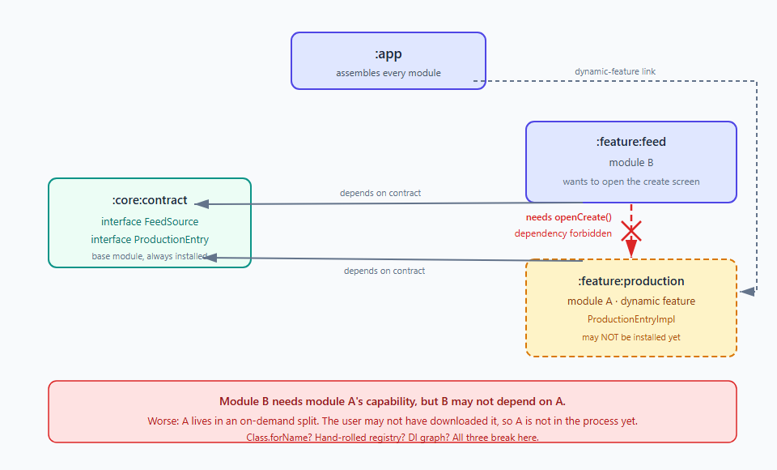
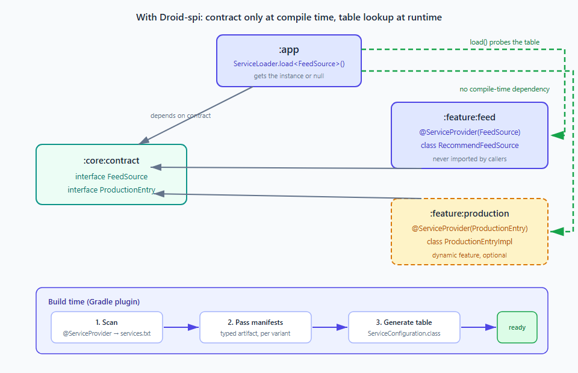

# Getting Started with Cross-Module Calls in droid-spi

*A compile-time service discovery framework for Android: the service interface is the contract between modules, any module can provide an implementation, and one `load()` gets you the instance at runtime. Zero reflection, zero annotation processing, and it works with on-demand dynamic feature modules.*

---

Push a multi-module app far enough and you hit the same wall:

**Module B needs a capability from module A, but B can't depend on A.**

The dependency arrow points the wrong way. Worse, A may not even be in the process yet. It lives in an on-demand dynamic feature module that the user hasn't tapped "Download" on. At that point you're left with the usual three options, none of them good:

- String class names plus `Class.forName`. Rename a class and nothing fails at compile time; the string quietly goes stale. R8 needs extra `-keep` rules, and an uninstalled module means `ClassNotFoundException`.
- A hand-rolled registry. Every feature has to remember to put its implementation in a map, someone has to trigger initialization in the right order, and key variants, debug/release differences, and dynamic modules all turn into hand-written `if` branches.
- A DI framework such as Hilt or Koin. These solve the assembly of a dependency graph that's closed at compile time. A module that isn't installed yet can't be a node in a compile-time graph, so the shape is wrong from the start.



droid-spi takes a different route: it keeps the calling shape of the JDK's `ServiceLoader` and moves the provider table to build time. In this post you'll wire it into a project and walk through three everyday scenarios. Once you've seen them, the wiring and registration code you used to write goes away.



**Note**: This post is based on `1.0.0`. Requirements: JDK 17, AGP 8.0–8.13 or 9.x, `minSdk 24`.

## See it in action first

Three steps. This is the entire everyday API:

```kotlin
// 1. The contract goes in a base module. Callers and implementers depend only on it.
interface FeedSource {
    fun load(page: Int, pageSize: Int): FeedPage
}

// 2. The implementation lives in its own module with one annotation.
//    Callers never import this class.
@ServiceProvider(service = FeedSource::class)
class RecommendFeedSource : FeedSource {
    override fun load(page: Int, pageSize: Int) = pagedIds(
        CommunityRepository.recommend(), page, pageSize,
    )
}

// 3. Look it up and use it anywhere. A missing service is null, not an exception.
val feed = ServiceLoader.load<FeedSource>()
recycler.submitList(feed?.load(page = 0, pageSize = 30)?.videoIds.orEmpty())
```

Notice what's absent from that code: no `@Inject`, no components or modules, no annotation-processing step, no class names as strings. Module B imports the contract interface and nothing else. Which module the implementation comes from, and whether that module is even installed, never leaks into the call site.

## Set up in five minutes

The plugin comes from the Gradle Plugin Portal and the libraries from Maven Central, so you don't need extra repositories:

```kotlin
// settings.gradle.kts, if your project doesn't declare these yet
pluginManagement {
    repositories { gradlePluginPortal() }
}
dependencyResolutionManagement {
    repositories { mavenCentral() }
}
```

```kotlin
// build.gradle.kts of every module that declares providers
plugins {
    // works with application, library, and dynamic-feature modules
    id("top.jayvin.droidspi") version "1.0.0"
}

dependencies {
    // modules with providers only need the annotation
    implementation("top.jayvin.droidspi:annotation:1.0.0")
    // modules that call ServiceLoader (like app) add the runtime
    implementation("top.jayvin.droidspi:runtime:1.0.0")
}
```

One optional step: initialize early in `Application.onCreate`. Skipping this is fine too; the configuration table lazy-loads on first query. Calling it up front just pins the cost to startup and surfaces problems like a missing generated class as soon as possible:

```kotlin
class MyApp : Application() {
    override fun onCreate() {
        super.onCreate()
        ServiceLoader.initialize()
    }
}
```

Setup is done. There's no annotation processor to run and no KSP or KAPT task slowing down incremental builds.

## One interface, multiple implementations: pick by key

An interface can host several implementations, selected by `key` at query time. This is the usual shape for a recommend feed next to a following feed:

```kotlin
@ServiceProvider(service = FeedSource::class, key = "following")
class FollowingFeedSource : FeedSource {
    override fun load(page: Int, pageSize: Int) = pagedIds(
        CommunityRepository.following(), page, pageSize,
    )
}
```

```kotlin
val recommend = ServiceLoader.load<FeedSource>()             // default implementation
val following = ServiceLoader.load<FeedSource>("following")  // a specific key
val all       = ServiceLoader.loadAll(FeedSource::class.java)   // key -> instance map
```

The rules are simple. A non-empty `key` must be unique, and two implementations fighting over the same key fail the build, which is what you want. An empty key is the default slot and can have multiple implementations; `load()` returns the first available one in a deterministic order that doesn't depend on your module layout. If the default slot has nothing and exactly one other key is available, `load()` falls back to it.

## Can't call `new`? Use `@ProviderFactory`

The generated table instantiates providers with `new Impl()` by default. Sometimes your implementation has a private constructor, or needs a parameter from its own dependency graph, like an account service that needs the login state:

```kotlin
@ServiceProvider(service = AccountService::class)
class AccountServiceImpl private constructor(
    private val session: UserSession,
) : AccountService {
    override fun userName() = session.currentUser.name

    companion object {
        // Created once, shared by all callers. The framework caches nothing itself.
        private val shared by lazy { AccountServiceImpl(AppGraph.userSession) }

        // In Kotlin this must be a @JvmStatic function in a companion object.
        // At most one factory per class.
        @ProviderFactory @JvmStatic
        fun create(): AccountServiceImpl = shared
    }
}
```

The framework calls this factory on every `load()` and caches no instances, so if you want a global singleton, return a cached field from the factory. That's what `shared` is doing above. The generated bytecode invokes the factory with `INVOKESTATIC`, so you still get zero reflection.

**Note**: The factory must be `static`, take no arguments, and return the implementation class itself. The static and uniqueness rules are checked at build time. The no-argument and return-type signature isn't, and a mistake surfaces as a `NoSuchMethodError` on first load. Keep the signature clean.

## Providers that don't exist yet

This is the App Bundle case that motivates the design.

Imagine a creation screen living in an on-demand dynamic feature module. The base module can't compile against `ProductionEntryImpl`, because that class isn't in the process until the user installs the split. The traditional approach needs an install listener and a manual registry refresh. Here there's nothing to wire:

```kotlin
// :modules:production. This call is legal even before the split is installed.
@ServiceProvider(service = ProductionEntry::class)
class ProductionEntryImpl : ProductionEntry {
    override fun openCreate(context: Context) {
        context.startActivity(Intent(context, ProductionHubActivity::class.java))
    }
}
```

The caller just probes:

```kotlin
fun onCreateClick(context: Context) {
    val production = ServiceLoader.load(ProductionEntry::class.java)
    if (production != null) {
        production.openCreate(context)   // installed: the implementation opens its own screen
    } else {
        installProduction()              // not installed: trigger Play Feature Delivery
    }
}
```

Before installation, `load()` returns `null` (and `stateOf()` tells you it's `MISSING`). After the split lands, the next `load()` returns the instance. There is no install listener or `refresh()` call, and the table never goes stale. The caller doesn't even know that `ProductionHubActivity` exists.

## Flavors and build types wire themselves

Each variant gets its own provider table. Implementations follow their source set and the framework picks the right one:

- A `ChannelService` implementation in `src/free` only ships in `free` builds; one in `src/vip` only ships in `vip` builds.
- A debug-only provider in `src/debug` simply has no entry in the release table.

No `if (BuildConfig.DEBUG)` sprinkled through half the app, no flavor-specific initializers. The DroidReel sample in the repo runs two flavors across two build types, and the profile screen's **SPI status** dialog shows each package's provider table live on a real device.

## How it compares

|  | Runtime reflection | Keyed implementations | Dynamic modules | Build cost |
|---|---|---|---|---|
| String class names | `Class.forName` | hand-written | hand-written | none |
| Hand-rolled registry | none | hand-written | install callback + manual refresh | none |
| JDK `ServiceLoader` / AutoService | reflective construction | no | throws `ServiceConfigurationError` | AutoService runs APT |
| DI (Hilt / Koin) | none | multibinding | outside the compile-time graph | Hilt runs KSP/KAPT |
| **droid-spi** | **none** | **`key`, table per variant** | **available on the next `load()`** | **one scan, no APT** |

A few details you'll appreciate daily:

- It never throws. An unavailable service is `null` or an empty collection. A service discovery layer shouldn't crash the app.
- It's R8 friendly. The generated table references providers with class literals and direct construction, so the shrinker treats it as ordinary code and needs no extra keep rules.
- `stateOf()` is probeable: `READY`, `MISSING`, and `DEAD`, which makes a self-check UI straightforward (that's where the DroidReel SPI status dialog came from).
- Third-party JDK SPI works too. If a library already ships a `META-INF/services/<interface FQN>` descriptor, drop that file into the module's source resources. No fork needed.

## When not to use it

Where it doesn't fit:

- If your dependency graph is fully closed at compile time and everything is always resident, use Hilt or Dagger. They bring scoping, lifetimes, and constructor injection, which this framework doesn't try to provide.
- If you need to load arbitrary plugin classes from disk at runtime, look elsewhere. This is a compile-time table; every provider must be visible to the build.
- The service interface must live in a base or always-resident module. Nested classes and `typealias` aren't supported.

It fills one gap: discovering a provider that may not be in the process yet, whether it lives in a dynamic feature module, a large modular app, or a variant-specific source set.

## Getting started checklist

1. Move the contract interface down into a base module.
2. In modules with implementations, apply the plugin, add the `annotation` dependency, and put `@ServiceProvider` on the implementation class.
3. Wherever you use the service, add the `runtime` dependency and call `ServiceLoader.load(...)`.
4. Optionally call `ServiceLoader.initialize()` in `Application.onCreate`, and add `@ProviderFactory` when construction isn't a plain `new`.

The plugin is on the Gradle Plugin Portal and the libraries are on Maven Central. The repo, with a full Compose sample (**DroidReel**, including the on-demand creation screen), is here:

👉 [github.com/Jayvinz/droid-spi](https://github.com/Jayvinz/droid-spi)

Code snippets in this post are covered by the repository's [Apache-2.0 license](../../LICENSE).

Curious how the plugin pulls this off without reflection or KSP? That's the next post: *How droid-spi Achieves Cross-Module Calls Without Reflection or KSP*.
