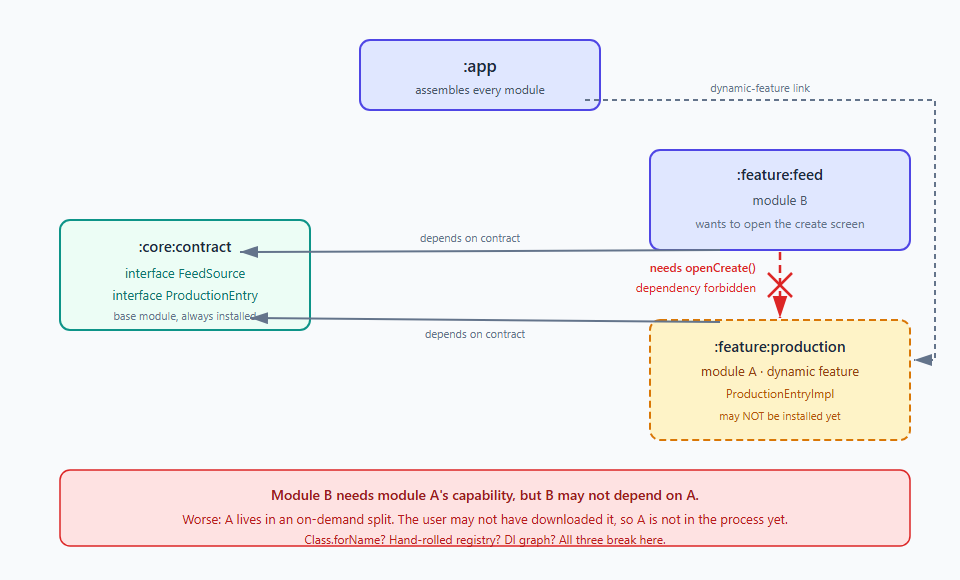
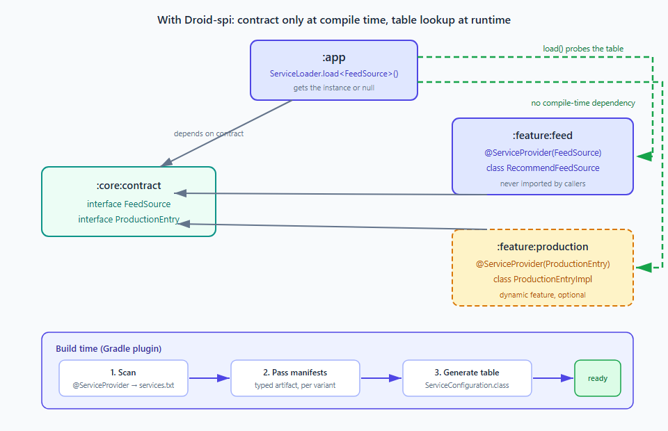

# 跨模块调用不用反射，也不用 KSP：Droid-spi 上手指南

*一个编译期的服务发现框架：把 service 接口当模块间契约，任意模块提供实现，运行时一句 `load()` 拿到实例——零反射、零注解处理，连按需下发的动态功能模块都能用。*

---

多模块拆到一定程度，你迟早会撞上这堵墙：

**业务模块 B 需要业务模块 A 的能力，但 B 不允许依赖 A。**

依赖箭头是反的。更糟的是，A 可能根本不在进程里——它躺在一个按需下载的动态功能模块里，用户还没点"下载"。这时候你会看到熟悉的三连：

- 字符串类名 + `Class.forName`：改个类名不报错，字符串悄悄失效；R8 要加 `-keep`；模块没装就 `ClassNotFoundException`。
- 手写注册表：每个 feature 记得往 map 里塞自己的实现，还要有人按对顺序触发初始化。key 变体、debug/release 差异、动态模块，最后全变成手写 `if`。
- DI 框架（Hilt/Koin）：解决的是**闭合依赖图**的装配问题。"还没安装的模块"不是一个能参与编译期依赖图的节点，形状就不对。



`Droid-spi` 走了另一条路：沿用 JDK `ServiceLoader` 的调用形状，把 provider 表**前移到构建期**。这篇文章带你把它接进工程，并用三个典型场景走一遍。读完你会发现，很多以前要接线、要注册、要写分支的东西，现在不存在了。



**Note**：本文基于 `1.0.0-alpha02`。需要 JDK 17、AGP 8.0–8.13 或 9.x、`minSdk 24`。

## 先看效果

三步，这是全部的日常 API：

```kotlin
// 1. 契约放 base 模块 —— 调用方和实现方都只依赖它
interface FeedSource {
    fun load(page: Int, pageSize: Int): FeedPage
}

// 2. 实现放在自己模块里，加一个注解，调用方永远不会 import 这个类
@ServiceProvider(service = FeedSource::class)
class RecommendFeedSource : FeedSource {
    override fun load(page: Int, pageSize: Int) = pagedIds(
        CommunityRepository.recommend(), page, pageSize,
    )
}

// 3. 任何地方查找使用 —— 缺失时是 null，不是异常
val feed = ServiceLoader.load<FeedSource>()
recycler.submitList(feed?.load(page = 0, pageSize = 30)?.videoIds.orEmpty())
```

注意这段代码里**没有的东西**：没有 `@Inject`，没有 component/module，没有代码生成插件的注解处理，没有字符串形式的类名。模块 B 的代码只 import 契约接口；实现来自哪个模块、那个模块装没装，都不会漏到调用处。

## 五分钟接入

插件来自 Gradle Plugin Portal，库来自 Maven Central，不需要额外仓库：

```kotlin
// settings.gradle.kts —— 如果项目里还没有声明
pluginManagement {
    repositories { gradlePluginPortal() }
}
dependencyResolutionManagement {
    repositories { mavenCentral() }
}
```

```kotlin
// 每个声明 provider 的模块 build.gradle.kts
plugins {
    // 支持 application、library、dynamic-feature 三种模块类型
    id("top.jayvin.droidspi") version "1.0.0-alpha02"
}

dependencies {
    // 有 provider 的模块只需要注解
    implementation("top.jayvin.droidspi:annotation:1.0.0-alpha02")
    // 需要调用 ServiceLoader 的地方（比如 app）加 runtime
    implementation("top.jayvin.droidspi:runtime:1.0.0-alpha02")
}
```

可选的一步：在 `Application.onCreate` 里提前初始化。不调用也行，配置表会在第一次查询时懒加载——提前调用只是把开销固定在启动阶段，并让"生成类缺失"这种问题在第一时间暴露：

```kotlin
class MyApp : Application() {
    override fun onCreate() {
        super.onCreate()
        ServiceLoader.initialize()
    }
}
```

装完了。没有 annotation processor 要跑，没有 KSP/KAPT 任务拖慢增量编译。

## 同一个接口，多个实现：用 key 选

一个接口可以挂多个实现，查询时按 `key` 挑——这是推荐流 / 关注流这类场景的常见需求：

```kotlin
@ServiceProvider(service = FeedSource::class, key = "following")
class FollowingFeedSource : FeedSource {
    override fun load(page: Int, pageSize: Int) = pagedIds(
        CommunityRepository.following(), page, pageSize,
    )
}
```

```kotlin
val recommend = ServiceLoader.load<FeedSource>()             // 默认实现
val following = ServiceLoader.load<FeedSource>("following")  // 指定 key
val all       = ServiceLoader.loadAll<FeedSource>()          // key -> 实例 的 map
```

规则很简单：**非空 key 必须唯一**，两个实现抢同一个 key 会直接构建失败（这正是你想要的）；空 key 是默认实现，可以有多个——`load()` 返回第一个可用的，顺序确定且与模块布局无关。

## 构造不走 `new`？用 @ProviderFactory

生成表默认用 `new Impl()` 实例化。但你的实现可能构造函数是 private 的，或者需要从自己的依赖图里拿参数——比如账户服务要拿登录态：

```kotlin
@ServiceProvider(service = AccountService::class)
class AccountServiceImpl private constructor(
    private val session: UserSession,
) : AccountService {
    override fun userName() = session.currentUser.name

    companion object {
        // 只创建一次，交给所有调用方。框架自身不做实例缓存。
        private val shared by lazy { AccountServiceImpl(AppGraph.userSession) }

        // Kotlin 必须写成 companion object 里的 @JvmStatic；每个类最多一个工厂
        @ProviderFactory @JvmStatic
        fun create(): AccountServiceImpl = shared
    }
}
```

框架每次 `load()` 都会调用这个工厂（不缓存实例），所以想要全局单例，就在工厂里返回缓存字段——上面的 `shared` 就是这个意思。生成的字节码用 `INVOKESTATIC` 直接调用工厂，依然零反射。

**Note**：工厂必须是 `static`、无参、返回实现类自身。"静态 + 唯一"两条在构建期校验；无参和返回类型签名没有构建期校验，写错会在首次加载时以 `NoSuchMethodError` 暴露——保持签名干净就好。

## 杀手锏：provider 可以"还不存在"

这是它对 App Bundle 真正有用的地方。

想象创作页放在按需下发的动态功能模块里。base 编译不到 `ProductionEntryImpl`——这个类在用户安装 split 之前根本不在进程里。传统做法要安装监听、手动刷新注册表。这里什么都不用：

```kotlin
// :modules:production —— 未安装时这个调用也合法
@ServiceProvider(service = ProductionEntry::class)
class ProductionEntryImpl : ProductionEntry {
    override fun openCreate(context: Context) {
        context.startActivity(Intent(context, ProductionHubActivity::class.java))
    }
}
```

调用方只是探测一下：

```kotlin
fun onCreateClick(context: Context) {
    val production = ServiceLoader.load(ProductionEntry::class.java)
    if (production != null) {
        production.openCreate(context)   // 已安装：实现自己打开页面
    } else {
        installProduction()              // 没装：走 Play Feature Delivery 下载 split
    }
}
```

安装前 `load()` 返回 `null`（`stateOf()` 会告诉你它是 `MISSING`）；split 装好后，**下一次 `load()` 就直接返回实例**。没有安装监听器，没有 `refresh()` 调用，没有"表没更新"的窗口。调用方甚至不知道 `ProductionHubActivity` 这个类名的存在。

## flavor / buildType 不用接线

每个 variant 有自己的 provider 表。实现跟着源集走，框架自动选对：

- `src/free` 里的 `ChannelService` 实现只进 `free` 包，`src/vip` 的只进 `vip` 包；
- 放在 `src/debug` 的调试专用 provider，release 的表里干脆没有这条记录。

以前要在半个应用里铺 `if (BuildConfig.DEBUG)` 或者写 flavor 专属初始化器？现在没有这个环节。仓库里的 DroidReel 示例有两个 flavor × 两个 buildType，个人主页的 **SPI 状态** 弹窗能直接在真机上看到每个包自己的 provider 表。

## 和传统方案比一比

|  | 运行时反射 | key 多实现 | 动态模块 | 构建成本 |
|---|---|---|---|---|
| 字符串类名 | `Class.forName` | 手写 | 手写 | 无 |
| 手写注册表 | 无 | 手写 | 安装回调 + 手动刷新 | 无 |
| JDK `ServiceLoader` / AutoService | 反射构造 | 无 | 抛 `ServiceConfigurationError` | AutoService 走 APT |
| DI（Hilt / Koin） | 无 | multibinding | 不在编译期图内 | Hilt 走 KSP / KAPT |
| **Droid-spi** | **无** | **`key` + 按 variant 成表** | **下一次 `load()` 即可用** | **一次扫描，无 APT** |

几个日常会感激的细节：

- **绝不抛异常**。不可用就返回 `null` / 空集合。服务发现层不应该让应用崩溃。
- **R8 友好**。生成表用类字面量和直接构造引用 provider，混淆器把它们当普通代码看，不需要额外 keep 规则。
- **`stateOf()` 可探测**：`READY` / `MISSING` / `DEAD` 三个状态，UI 上做个自检很方便（DroidReel 的 SPI 状态弹窗就是这么来的）。
- **第三方 JDK SPI 也能接**。已有 `META-INF/services/<接口 FQN>` 描述文件的库，把该文件放进模块的 source resources 即可，不用 fork。

## 什么时候不该用它

诚实的边界比功能列表更有用：

- **依赖图在编译期就全部闭合、全部常驻**？用 Hilt/Dagger。它们有作用域、生命周期、构造注入，这些不是本框架试图提供的东西。
- **需要运行时加载磁盘上的任意插件类**？本框架是编译期表，每个 provider 都必须对构建可见。
- service 接口必须放 base / 常驻模块，不支持嵌套类和 `typealias`。

它填的空白就一句话：**"发现一个此刻可能还不在进程里的 provider"**——动态功能模块、大型模块化应用、随变体变化的实现。

## 上手清单

1. 契约接口下沉到 base 模块。
2. 在有实现的模块 apply 插件 + 加 `annotation` 依赖，给实现类挂 `@ServiceProvider`。
3. 在用到服务的地方加 `runtime` 依赖，写 `ServiceLoader.load(...)`。
4. （可选）`Application.onCreate` 里 `ServiceLoader.initialize()`；需要自定义构造就加 `@ProviderFactory`。

插件发布在 Gradle Plugin Portal，库在 Maven Central。仓库和完整示例（Compose 短视频 demo **DroidReel**，含动态下发的创作页）：

👉 [github.com/Jayvinz/droid-spi](https://github.com/Jayvinz/droid-spi)

想看它内部为什么长这样——扫描器怎么写、清单怎么跨工程传递、生成的字节码为什么刻意不带静态初始化块——下一篇《编译期 SPI 的插件开发原理》见。
