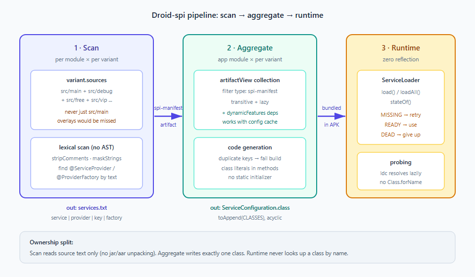
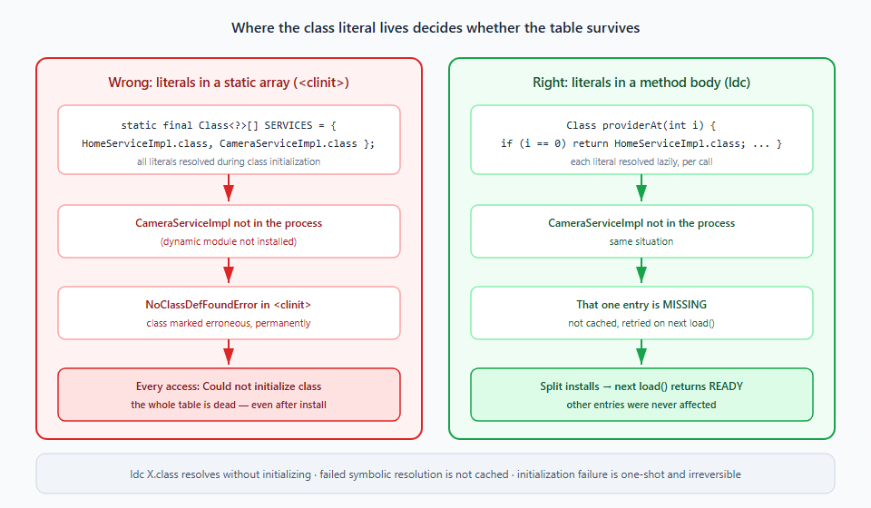

# How droid-spi Achieves Cross-Module Calls Without Reflection or KSP

*For developers who want to write their own build plugins: how droid-spi's three-stage pipeline works (source scanning, manifest passing, bytecode generation), and the three JVM semantics that decide whether the whole thing holds together. The code fits in an afternoon. What costs time is knowing which "obviously correct" implementations quietly fail.*

---

Last post got droid-spi working. This one explains why it's built the way it is.

Set yourself a target first. You want a Gradle plugin that moves the service registry from run time to compile time: each module scans its own `@ServiceProvider` annotations, the app aggregates one provider table, and the runtime looks up and constructs providers with zero reflection. It sounds like a simple "scan and generate code" job.

The code is small. But four traps hide in it, and each one makes your first version work perfectly in hot builds and then fail silently in some stricter environment:

1. Parsing source with an AST or compiler API ties you to compiler internals that move between versions.
2. Collecting manifests through a shared build service breaks the task graph when configuration cache reuse kicks in.
3. Class literals in a static initializer mean one uninstalled module poisons the entire table.
4. Caching "provider doesn't exist" means the dynamic module is never found after it installs.

Below I walk the pipeline in order. When you're done, you should be able to judge for yourself which decisions must be right if you write a compile-time registry plugin of your own.

**Note**: The implementation lives in three modules of [Jayvinz/droid-spi](https://github.com/Jayvinz/droid-spi): `plugin/`, `runtime/`, and `configuration-stub/`. About 1,700 lines of main source across the three modules, which you can read in an afternoon.

## The pipeline at a glance



The responsibility split is the first design question:

- **Scanning** reads source text only (annotation source plus standard `META-INF/services` text). It never touches compiled outputs and never unpacks dependency jars or AARs.
- **Aggregation** runs in the app module. Input is plain text, output is one class.
- **Runtime** does state queries and on-demand probing. There is no "find a class by name" step anywhere.

Why not scan third-party jars? Because that means unpacking and repacking hundreds of megabytes of AARs. To adopt a third-party implementation that declares itself through JDK SPI conventions, copy its `META-INF/services/<interface FQN>` text into your own source tree. Read your own text only, never touch dependency artifacts. It's a deliberate trade: a little inconvenience for a lot of build speed.

## Stage one: the scanner is lexical, not AST

For every variant of every module, register a `{variant}ScanProviders` task (for example, `freeDebugScanProviders`) whose inputs come from AGP's `variant.sources` (`java.static`, `kotlin.static`, `resources.static`). **This detail matters**: scanning `src/main` directly misses `src/debug`, `src/free`, and every other overlay. Variant awareness has to start at the input side.

Source parsing is deliberately not an AST. Two passes, both preserving character offsets:

| Pass | What it does | Why |
|---|---|---|
| `stripComments` | replaces comments with spaces | values like `key = "vip"` live in string literals, which must stay readable |
| `maskStrings` | replaces string contents with spaces | a literal `@ServiceProvider` inside a string shouldn't look like an annotation |

Then: locate the annotation, split top-level arguments with bracket matching, search forward from the closing bracket for the class declaration, look for `@ProviderFactory` in the class body. The output is a deterministic manifest, one line per provider:

```
service <TAB> provider <TAB> key <TAB> factory
```

> **A lesson for plugin authors**: Lexical scanning behaves the same for Java and Kotlin sources and doesn't depend on Kotlin compiler internals (those APIs move between versions). The cost is doing your own type resolution. Here too there's a trade: explicit `import` wins, then same-package, then a unique name in the module. An `import a.b.*` is a hard build failure. Better to fail than guess: a wrong fully qualified name doesn't surface at build time, it surfaces at run time as `NoClassDefFoundError`.

## Stage two: manifest passing, or why shared build services are wrong

This is the most instructive failure in the whole project.

The first version felt natural: a root project extension plus a shared build service, every module publishing its manifest into a central map, the app reading it at the end of the configuration phase. Hot builds worked fine. Then configuration cache reuse (especially with isolated projects) failed silently:

- When one project's `Provider<RegularFile>` is held as a task input by another project's task, configuration cache reuse serializes it into a plain file path.
- The scan task **disappears** from the task graph while the generate task keeps reading the old file.
- The build "succeeds" with a stale table. Nothing complains.

The fix was to return to a mechanism Gradle already models correctly: **variant-aware artifact resolution**.

- Each module variant attaches its `services.txt` to `{variant}RuntimeElements` as a custom artifact type, `spi-manifest`.
- The app's generate task takes an `artifactView` of `variant.runtimeConfiguration` filtered by that type. Resolution is transitive and lazy, so modules without the plugin simply contribute nothing.
- Dynamic feature modules aren't on the app's runtime classpath, so the app adds a dependency for each project in its own `dynamicFeatures` and takes the same filtered view.
- The generate task writes its class with `toAppend(ScopedArtifact.CLASSES)` and does **not** read the `CLASSES` input, so the task graph stays acyclic.

> **A lesson for plugin authors**: When data has to cross projects, make it a typed artifact. Shared services and root extensions will make you think you're right in up-to-date hot builds; only configuration cache reuse and isolated projects expose the broken edges. Also: `toAppend` beats `toTransform` here. The generate task doesn't read classes, it appends one file, so nothing needs repackaging.

## Stage three: bytecode generation, three rules

The generated class is plain. Fixed fully qualified name `top.jayvin.android.spi.generated.ServiceConfiguration`, implementing a small interface:

```kotlin
interface ProviderConfiguration {
    fun services(): Array<Class<*>>
    fun keys(): Array<String>
    fun providerAt(index: Int): Class<*>?   // resolves only, no initialization
    fun newProviderAt(index: Int): Any?     // resolves + instantiates
}
```

### Rule 1: never generate a `<clinit>`

This is the invariant the whole design rests on.

The naive generator writes the table as a static array:

```java
static final Class<?>[] SERVICES = { HomeServiceImpl.class, CameraServiceImpl.class, ... };
```

Looks completely reasonable. But suppose `CameraServiceImpl` lives in a dynamic module that isn't installed: resolving that literal **during class initialization** throws `NoClassDefFoundError`, and the JVM marks `ServiceConfiguration` as *erroneous* for the rest of the process. Installing the module later doesn't help; every access is `Could not initialize class` and **the whole table is dead**.



So the generator looks like this instead:

```java
public Class providerAt(int index) {
    if (index == 0) return HomeServiceImpl.class;    // ldc instruction, inside a method body
    if (index == 1) return VipHomeServiceImpl.class; // lazy resolution, recoverable
    ...
}
```

Every class literal is an `ldc` in a method body. One failure affects one entry, and the next call can retry.

**Note**: The generator does one more small thing: ASM's `ClassWriter.getCommonSuperClass` is forced to return `java/lang/Object`. The default implementation tries to load those implementation classes on the build JVM to compute a common superclass, and they may not exist on the build classpath at all.

### Rule 2: `services()` and `keys()` share one index space

Each entry occupies one index, and provider methods are addressed by index. Register two keys for the same interface and `services()` lists it twice, which is correct; a dispatch structure that keys on the service class alone would collapse them. Multiple default implementations (empty key) each get their own index too, and `load()` returns the first available one in the deterministic order of `(service, key, provider FQN)`.

### Rule 3: construction through INVOKESPECIAL / INVOKESTATIC, never reflection

A provider without a factory gets `new` plus `INVOKESPECIAL <init>`. A `@ProviderFactory` generates `INVOKESTATIC Impl.create()LImpl;` with the descriptor assembled statically at build time. No `Class.forName`, no `Constructor.newInstance`, no `Method.invoke`. A pleasant side effect: R8 sees ordinary code here, method names don't need keep rules, and nothing in the table is invisible to the shrinker.

## Three JVM semantics that decide everything

The rules above aren't superstition. They're direct consequences of three textbook behaviors:

1. **`ldc X.class` resolves but doesn't initialize.** That's what lets `providerAt` split "is the class in the dex" from "can the class initialize" into two phases, which is the precondition for `MISSING` and `DEAD` being distinguishable at all.
2. **Class initialization failure is one-shot.** After `<clinit>` throws, the class is marked erroneous and every later access is `Could not initialize class`, irreversible within the process. That's why `ExceptionInInitializerError` must be terminal (`DEAD`) and never retried.
3. **Failed symbolic resolution isn't cached.** Run the same `ldc` again after the module installs and the constant pool entry is still unresolved, so this time the class is found and it succeeds. This is the mechanism behind "works on the next `load()` after install, no refresh needed".

Put together: the literals must live in method bodies. In a `<clinit>` they poison the entire table. After a failure, a retry can succeed. WMRouter's registry puts its literals in one-shot initialization, so a single failing `ldc` takes down the whole table, and that's precisely why this design insists on the rule.

## The runtime: a three-state machine

The registry (`ProviderRegistry`) translates the semantics above into states callers can act on:

| State | Meaning | Entered when | Cached? |
|---|---|---|---|
| `MISSING` | class not visible right now (module not installed) | `ldc` throws `NoClassDefFoundError` | **no**, retry next time |
| `READY` | resolvable and instantiable | construction succeeds | no (instances aren't cached either) |
| `DEAD` | unavailable and retrying is pointless | `<clinit>` fails | **yes**, never tried again in this process |

`load()` tries each matching entry through `newProviderAt()`: an absent class yields `null`, and an entry whose `<clinit>` failed is marked `DEAD` and skipped from then on. It returns the first success. The facade is deliberately total: if the generated class is missing it logs one error and degrades to an empty configuration, so every query returns `null` or an empty collection. A service discovery layer shouldn't crash the app because one module isn't installed.

> **A lesson for plugin authors**: Distinguish "failed temporarily" from "failed permanently", and cache only the second kind. That requires your generated output to separate resolution from instantiation (`providerAt` vs `newProviderAt`). The API shape serves recoverability.

## Build correctness: don't skip the verification matrix

The plugin emits bytecode, and wrong bytecode doesn't fail compilation, so verification has to be deliberate:

- Determinism: sorted manifests, no timestamps. Both tasks `@CacheableTask`, source inputs `PathSensitivity.RELATIVE`. Copy the project byte-for-byte to another absolute path and the build cache must still hit.
- Incremental builds: adding or removing one `@ServiceProvider` reruns that module's scan and the app's generate; reverting is FROM-CACHE.
- Configuration cache and isolated projects: store, reuse, edit sources while reusing, build again.
- Variant matrix: `javap` the generated class per variant and confirm it contains only that variant's providers and no `<clinit>`.
- On-device end to end: the `MISSING → READY` transition (dynamic module installed, no process restart) only counts when it actually runs. Builds "succeed" either way and won't tell you the generated class was never appended in some variant.

## If you want to build one yourself

Compressed into a checklist:

1. **Be variant-aware at the input side**. Use `variant.sources`, never `src/main`.
2. **Lexical scanning beats AST** unless you're willing to track compiler internals across versions.
3. **Cross-project manifests are typed artifacts**. Shared services break silently under configuration cache.
4. **No `<clinit>` in generated classes**. Class literals go in method bodies, or one missing class poisons the whole table.
5. **Separate resolution from initialization**. Cache irreversible failures (`DEAD`) only; recoverable ones (`MISSING`) are never cached.
6. **Zero reflection also buys R8 visibility**. `ldc` / `new` / `INVOKESTATIC` keep providers visible to the shrinker without keep rules.
7. **The verification matrix is part of the plugin**: deterministic output, cache hits, configuration cache reuse, on-device state checks.

The implementation stays deliberately small: one scanner, one ASM writer, one registry, one facade. Most of the real work is finding which Gradle and JVM assumptions don't survive dynamic delivery and configuration cache. If you build plugins for a living, that sentence probably sounds familiar.

---

Trade-offs, for the record: compile-time only (providers must be visible to the build), explicit keys must be unique, service interfaces live in base modules, and there's no scoping, lifetime, or constructor injection. For a dependency graph that's closed at compile time, use Hilt or Dagger. This framework serves the part of the graph that is *not guaranteed* to exist in the process.

Repository and design doc: [github.com/Jayvinz/droid-spi](https://github.com/Jayvinz/droid-spi) · `docs/droid-spi-design.md`
Code snippets in this post are covered by the repository's [Apache-2.0 license](../../LICENSE).
Previous post: *Getting Started with Cross-Module Calls in droid-spi*
