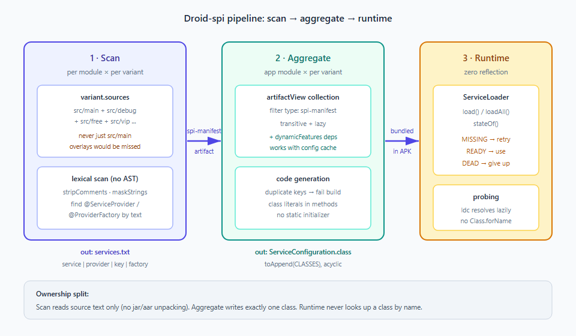
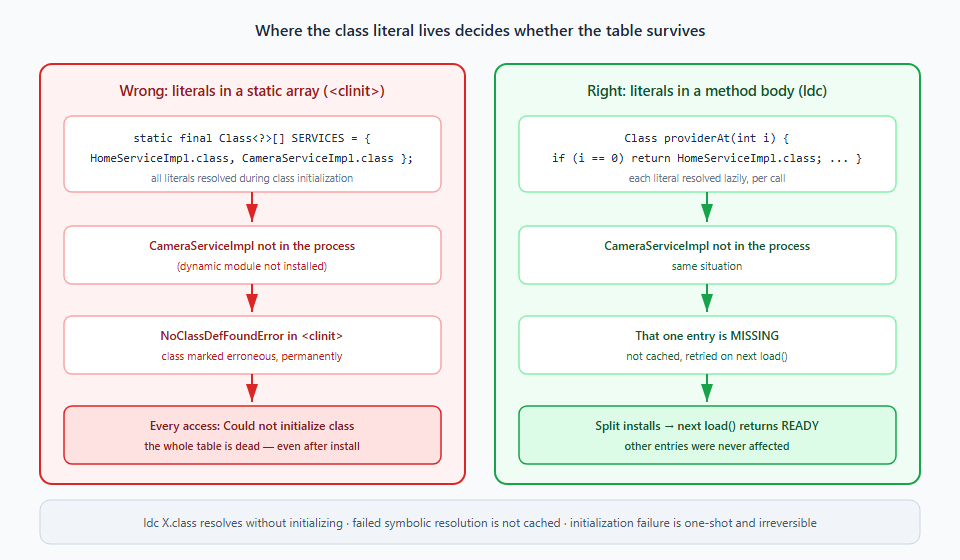

# 不用反射和 KSP，droid-spi 如何实现跨模块调用

*给想自己动手写构建插件的人：拆解 droid-spi 的三段流水线——源码扫描、清单传递、字节码生成——以及三个决定成败的 JVM 语义。代码量不难，难在判断哪些"显然正确"的实现会在配置缓存和动态下发下失效。*

---

上一篇我们把 droid-spi 用了起来。这一篇讲它为什么长成这样。

先立个靶子。你要写一个 Gradle 插件，目标是：**把服务注册表从运行时前移到编译期**——各模块扫描自己的 `@ServiceProvider`，app 聚合出一张 provider 表，运行时零反射地查表构造。听起来就是个"扫描 + 生成代码"的活。

代码量不大。但这里藏着四个坑，每一个都会让你的第一版实现**在热构建里完全正常，然后在某个更严格的环境里静默出错**：

1. 用 AST 或编译器 API 解析源码——被 Kotlin/Java 编译器的内部结构绑死；
2. 用共享 build service 跨工程收集清单——配置缓存复用时任务图断裂；
3. 把类字面量写进生成类的静态初始化块——一个未安装的模块毒化整张表；
4. 缓存"provider 不存在"的结论——动态模块装好后永远找不到它。

下面按流水线顺序拆。读完你应该能独立判断：如果你要写一个"编译期注册表"插件，哪些决定是必须做对的。

**Note**：涉及的实现都在 [Jayvinz/droid-spi](https://github.com/Jayvinz/droid-spi) 的 `plugin/`、`runtime/` 和 `configuration-stub/` 三个模块的主源码合计约 1700 行，一个下午真能读完。

## 总体架构：三段流水线



职责切分是第一道设计题：

- **扫描**只读源码文本（注解源码 + 标准 `META-INF/services` 文本），不碰编译产物、不解压依赖 jar/aar；
- **聚合**在 app 模块跑，输入纯文本，输出一个 class；
- **运行时**只做状态查询和按需探测，没有任何"按名字找类"的动作。

为什么不扫第三方 jar？因为那意味着解压重组数百 MB 的 AAR。想接入按 JDK SPI 约定声明的第三方实现，把它的 `META-INF/services/<接口 FQN>` 文本**拷到本工程源码目录**即可——只读自有文本，不碰依赖产物。这是个用一点不便换构建性能的自觉取舍。

## 阶段一：扫描器——词法级，而不是 AST

对每个模块的每个 variant，注册一个 `{variant}ScanProviders` 任务（如 `freeDebugScanProviders`），输入来自 AGP 的 `variant.sources`（`java.static`、`kotlin.static`、`resources.static`）。**这个细节很重要**：直接扫 `src/main` 会漏掉 `src/debug`、`src/free` 和其他所有叠加层——variant 感知要从输入端就开始。

源码解析刻意不做成 AST。做法是两级处理，都保持**字符偏移不变**：

| 处理 | 做什么 | 为什么 |
|---|---|---|
| `stripComments` | 注释替换为空格 | 要读 `key = "vip"` 这类取值，字符串必须留着 |
| `maskStrings` | 字符串内容替换为空格 | 结构扫描时避免把字符串里的 `@ServiceProvider` 当真 |

然后：定位注解 → 括号配对切分顶层参数 → 从右括号向后找类声明 → 类体内找 `@ProviderFactory`。输出是一行一条的确定性清单：

```
service <TAB> provider <TAB> key <TAB> factory
```

> **给插件作者的经验**：词法级扫描对 Java 和 Kotlin 源码行为一致，不依赖 Kotlin 编译器内部结构（那些 API 在版本间会动）。代价是你自己处理类型解析——这里同样有取舍：显式 `import` 优先，同包次之，模块内唯一名再次；碰到 `import a.b.*` 就**直接构建失败**。宁可失败不猜：猜错的全限定名不会在构建期暴露，只会在运行时变成 `NoClassDefFoundError`。

## 阶段二：清单传递——为什么"共享 build service"是错的

这是整个项目里最有教育意义的一段翻车史。

第一版实现很自然：根项目开个扩展 + 共享 build service，每个模块把清单发布到中央 Map，app 在配置阶段结束时读。热构建里完全正常。然后配置缓存复用（尤其是 isolated projects）下**静默出错**：

- 一个工程的 `Provider<RegularFile>` 被另一个工程的任务持有为输入时，配置缓存复用会把它序列化成普通文件路径；
- scan 任务从任务图里**消失**，generate 任务还在读旧文件；
- 构建"成功"了，但表是过期的。没有任何报错。

修复方案是回到 Gradle 已经建模正确的机制：**variant-aware artifact 解析**。

- 每个模块 variant 把 `services.txt` 以自定义 artifact 类型 `spi-manifest` 附加到 `{variant}RuntimeElements` 上；
- app 的生成任务对 `variant.runtimeConfiguration` 取 `artifactView`，按该类型过滤。解析是传递且惰性的，没应用插件的模块自然不贡献任何东西；
- 动态功能模块不在 app 的运行时 classpath 上——app 对自己 `dynamicFeatures` 里的每个工程补一条依赖，取同样的过滤视图；
- 生成任务用 `toAppend(ScopedArtifact.CLASSES)` 写出 class，且**不读** `CLASSES` 输入，任务图不成环。

> **给插件作者的经验**：跨工程传数据，永远优先"把它变成一个带类型的 artifact"。共享服务和根扩展在 up-to-date 热构建里会让你以为自己对了；只有配置缓存复用和 isolated projects 会揭穿它。顺带：`toAppend` 优于 `toTransform`——生成任务不读 classes，只追加一个文件，不需要把全部输入重新打包。

## 阶段三：字节码生成——三条铁律

生成的类很朴素：固定全限定名 `top.jayvin.android.spi.generated.ServiceConfiguration`，实现一个小接口：

```kotlin
interface ProviderConfiguration {
    fun services(): Array<Class<*>>
    fun keys(): Array<String>
    fun providerAt(index: Int): Class<*>?   // 只解析，不触发初始化
    fun newProviderAt(index: Int): Any?     // 解析 + 实例化
}
```

### 铁律一：不生成 `<clinit>`

这是整个设计最重要的不变量。

朴素的生成器会把表写成静态数组：

```java
static final Class<?>[] SERVICES = { HomeServiceImpl.class, CameraServiceImpl.class, ... };
```

看起来完全合理。但假设 `CameraServiceImpl` 在一个还没安装的动态模块里：**类初始化期间**解析该字面量失败，抛 `NoClassDefFoundError`，JVM 会把 `ServiceConfiguration` 整个类标记为 *erroneous*，在进程内不可恢复。之后模块装好了也没用，每次访问都是 `Could not initialize class`，**整张表报废**。



所以生成器长这样：

```java
public Class providerAt(int index) {
    if (index == 0) return HomeServiceImpl.class;    // ldc 指令，方法体内
    if (index == 1) return VipHomeServiceImpl.class; // 惰性解析，可恢复
    ...
}
```

所有类字面量都是方法体里的 `ldc`。一个失败只影响一条目，下一次调用还能重试。

**Note**：生成器还有个小动作——ASM `ClassWriter` 的 `getCommonSuperClass` 被强制返回 `java/lang/Object`。默认实现会在构建 JVM 上尝试加载那些实现类来算公共父类，而它们可能根本不存在于构建类路径上。

### 铁律二：`services()` / `keys()` 下标对齐

每个条目占一个下标，provider 方法也以下标寻址。同一接口注册两个 key，`services()` 里就出现两次——按 key 分派的结构只能返回其中一个，会塌缩。多个默认实现（空 key）同理，各自占一个下标，`load()` 按 `(service, key, provider FQN)` 的确定顺序返回第一个可用的。

### 铁律三：构造走 `INVOKESPECIAL` / `INVOKESTATIC`，不走反射

无工厂的 provider 直接 `new` + `INVOKESPECIAL <init>`；`@ProviderFactory` 生成 `INVOKESTATIC Impl.create()LImpl;`，描述符在构建期静态拼装。没有 `Class.forName`，没有 `Constructor.newInstance`，没有 `Method.invoke`。副产品是 R8 把这些当普通代码——方法名不参与混淆，不需要 keep 规则。

## 决定这一切的三条 JVM 语义

上面的"铁律"不是迷信，是三条教科书语义的直接推论：

1. **`ldc X.class` 只解析、不初始化。** 所以 `providerAt` 天然把"类在不在 dex 里"和"类能不能正确初始化"拆成两个阶段——这是 `MISSING` 和 `DEAD` 能分开的前提。
2. **类初始化失败是一次性的。** `<clinit>` 抛错后类被标记 erroneous，后续访问永远是 `Could not initialize class`，进程内不可逆。所以 `ExceptionInInitializerError` 必须判死（`DEAD`），不能重试。
3. **符号引用解析失败不被缓存。** 模块装好后再执行同一条 `ldc`，常量池项还是未解析状态，这次能找到类就成功。这是"装好后下一次 `load()` 自动可用、无需 refresh"的底层依据。

三条合起来才推出那个结论：**字面量必须放方法体；放 `<clinit>` 会毒化整表；失败后可以重试**。WMRouter 的注册表就是把字面量放进一次性初始化里，一条 `ldc` 失败整表失效——这也是本设计坚持这条铁律的直接原因。

## 运行时：一个三状态的小状态机

注册表（`ProviderRegistry`）把上述语义翻译成用户可理解的状态：

| 状态 | 含义 | 进入条件 | 缓存？ |
|---|---|---|---|
| `MISSING` | 类当前不可见（模块没装） | `ldc` 抛 `NoClassDefFoundError` | **不缓存**，下次重试 |
| `READY` | 可解析、可实例化 | 构造成功 | 不缓存（实例也不缓存） |
| `DEAD` | 不可用且重试无意义 | `<clinit>` 失败 | **缓存**，本进程不再尝试 |

`load()` 对每个匹配条目调 `newProviderAt()`：类缺失时得到 `null`，`<clinit>` 失败的条目标记为 `DEAD`、此后跳过，返回第一个成功的实例。门面刻意设计为全函数：生成类缺失时打一条 error、降级为空配置，所有查询返回 `null`/空集合——服务发现层不应该因为一个模块没装就让应用崩溃。

> **给插件作者的经验**：区分"暂时失败"和"永久失败"，只缓存后者。这需要你的生成物把"解析"和"初始化"分成两个动作（`providerAt` vs `newProviderAt`）——API 形状服务于可恢复性。

## 构建正确性：别忘了验证矩阵

插件输出的是字节码，错了不报编译错误，所以验证要刻意做：

- **确定性**：清单排序、无时间戳；两个任务都 `@CacheableTask`，源码输入 `PathSensitivity.RELATIVE`——把工程按字节复制到另一个绝对路径，构建缓存必须照样命中；
- **增量**：增删一个 `@ServiceProvider` 重跑该模块的 scan 和 app 的 generate，还原后 FROM-CACHE；
- **配置缓存 / isolated projects**：存储、复用、复用状态下改源码再构建；
- **变体矩阵**：每个 variant 用 `javap` 检查生成类只含自己的 provider、无 `<clinit>`；
- **真机端到端**：`MISSING → READY` 的切换（动态模块安装后不重启进程直接可用）只有跑起来才算数——构建永远"成功"，发现不了生成类压根没被追加的变体。

## 写给想自己动手的人

如果要把这套经验压缩成一张清单：

1. **输入端就要 variant 感知**——用 `variant.sources`，别碰 `src/main`。
2. **词法扫描优于 AST**——除非你愿意跟着编译器内部 API 的版本变化走。
3. **跨工程传清单 = 带类型的 artifact**，共享服务在配置缓存下会静默断边。
4. **生成类禁止 `<clinit>`**——类字面量只进方法体，否则一个缺失的类毒化整表。
5. **解析与初始化分离**，只缓存不可逆失败（`DEAD`），可恢复失败（`MISSING`）永不缓存。
6. **零反射顺带换来 R8 可见性**——`ldc`/`new`/`INVOKESTATIC` 让 provider 对混淆器保持可见，不需要 keep 规则。
7. **验证矩阵是插件的一部分**——确定性输出、缓存命中、配置缓存复用、真机状态检查。

实现刻意保持精简：一个扫描器、一个 ASM writer、一个注册表、一个门面。真正花时间的是找出哪些 Gradle 与 JVM 的假设在动态下发和配置缓存下不成立。

---

取舍提醒：本框架仅限编译期（provider 必须对构建可见）；显式 key 唯一；service 接口必须在 base 模块；不提供作用域、生命周期和构造注入——编译期闭合的依赖图请用 Hilt/Dagger。它服务的是依赖图中*不保证*存在于进程内的那一部分。

仓库与设计文档：[github.com/Jayvinz/droid-spi](https://github.com/Jayvinz/droid-spi) · `docs/droid-spi-design.md`
本文代码片段遵循仓库的 [Apache-2.0 许可](../../LICENSE)。
上一篇：《跨模块调用：droid-spi 上手指南》
